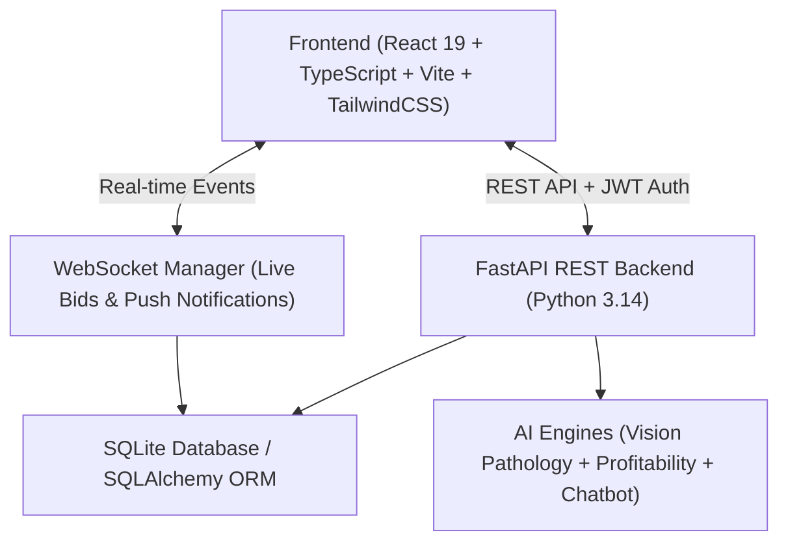

# 🌾 Smart Krishi Connect (FarmChain)

> **Transparent Farm-to-Fork Digital Trading & Agri-Intelligence Platform**  
> Empowering Farmers, Connecting Merchants, and Streamlining Rural Supply Chains.

---

## 🌟 Overview

**FarmChain (Smart Krishi Connect)** is a comprehensive full-stack agricultural marketplace and intelligence platform designed to eliminate predatory middlemen from agricultural supply chains in India.

The platform provides:
- **⚡ Live APMC Bidding Floor**: Real-time merchant bidding via WebSockets with transparent Reserve Base Prices and automated Cost-of-Production Profit Margin calculations.
- **📊 Mandi Intelligence & Net Realized Price Calculator**: Multi-mandi price feed analysis with automated freight deduction to determine the most profitable destination market.
- **🚚 Smart Transport & Logistics Engine**: Automatic vehicle class recommendation based on load weight (Qtl) and distance (km), instant freight quotes, and status tracking.
- **🌿 AI Plant Doctor**: Visual crop pathology analysis for leaves, diagnosing fungal, bacterial, and pest attacks with dual organic and chemical treatment recommendations.
- **🛍️ Verified Pesticide & Agri-Inputs Store**: Direct procurement of certified bio-fungicides, neem formulations, and bio-stimulants.
- **🤖 Krishi Sahayak Multilingual AI Assistant**: Chatbot grounded in live Mandi rates, orders, logistics, and pathology across **English**, **हिंदी (Hindi)**, and **मराठी (Marathi)**.
- **👥 Multi-Persona Demo Switching**: 1-click switcher between **Farmer**, **Merchant**, **Transporter**, **Input Seller**, and **Admin**.
- **🎨 Multi-Theme Visual Design**: Includes **Pristine Light**, **Obsidian Dark**, and **Sapphire Light** themes.

---

## 🏗️ Architecture & Tech Stack



- **Frontend**: React 19, TypeScript, Vite, TailwindCSS, Lucide Icons, Canvas Confetti
- **Backend**: Python, FastAPI, SQLAlchemy, Uvicorn, Pydantic, PyJWT, Passlib, Bcrypt
- **Database**: SQLite (zero-config, portable) / PostgreSQL ready
- **Realtime**: WebSockets for live room bidding and instant outbid toast notifications
- **Testing**: PyTest with automated test coverage

---

## 🚀 Quick Start Guide

### Prerequisites
- **Node.js**: v18+ & `npm`
- **Python**: 3.10+ (with `venv`)

### 1. Clone the Repository
```bash
git clone https://github.com/<your-username>/FarmChain.git
cd FarmChain
```

### 2. Backend Setup
```bash
# Navigate to backend
cd backend

# Create virtual environment (if not present)
python -m venv venv

# Activate virtual environment
# On Windows:
.\venv\Scripts\activate
# On Linux/macOS:
source venv/bin/activate

# Install dependencies
pip install -r requirements.txt

# Start FastAPI backend server
python -m uvicorn backend.app.main:app --reload --host 127.0.0.1 --port 8000
```
- Interactive Swagger API Documentation: [http://127.0.0.1:8000/docs](http://127.0.0.1:8000/docs)

### 3. Frontend Setup
```bash
# Navigate to frontend (in a new terminal)
cd frontend

# Install dependencies
npm install

# Start Vite development server
npm run dev
```
- App UI: [http://localhost:5173](http://localhost:5173)

### 4. Run Automated Backend Tests
```bash
cd backend
pytest
```

---

## 👥 Demo Personas (Pre-configured 1-Click Login)

| Role | Name | Location | Phone / Login |
| :--- | :--- | :--- | :--- |
| 🌱 **Farmer** | Ramesh Patil | Dindori, Nashik | `9876543210` / `password123` |
| 🌱 **Farmer** | Gurpreet Singh | Ludhiana, Punjab | `9876543211` / `password123` |
| 🏪 **Merchant** | Suresh Traders | APMC Vashi, Mumbai | `9876543220` / `password123` |
| 🏪 **Merchant** | Vijay Mehra | Azadpur Mandi, Delhi | `9876543221` / `password123` |
| 🚛 **Transporter** | Mahendra Shinde | Nashik, Maharashtra | `9876543230` / `password123` |
| 🧪 **Input Seller** | AgroCare Center | Nashik, Maharashtra | `9876543240` / `password123` |
| 🛡️ **Admin** | APMC Market Supervisor | Mumbai, Maharashtra | `9876543250` / `password123` |

---

## 📄 License
MIT License. Developed for transparent agricultural commerce and farmer empowerment.
